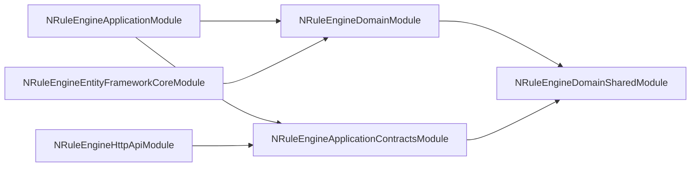
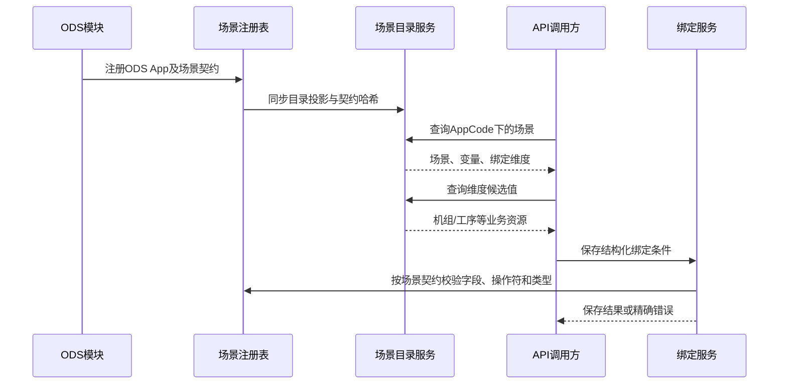
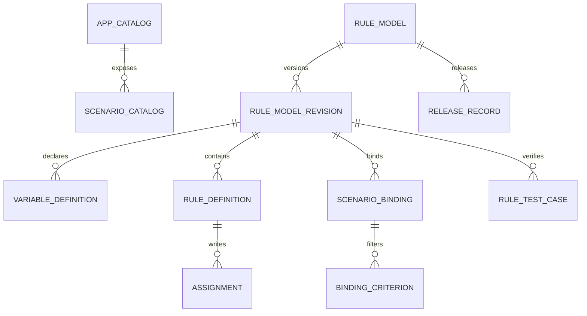

# NRuleEngine 系统设计草案

> 状态：讨论稿  
> 版本：v0.9  
> 日期：2026-09-23  
> 范围：通用组件架构、领域模型、场景扩展、接口和技术验收  
> 设计基线：与《NRuleEngine 产品设计草案》v0.9 对齐

## 1. 架构决策索引

以下为已确认的架构决策。每条单独成篇，记录上下文、考虑过的替代方案与后果。

| # | 决策 | 状态 | ADR |
|---|---|---|---|
| 1 | 全新设计，不继承旧 RuleEngine 的表结构和命名 | 已接受 | [ADR-0001](../adr/0001-new-design-not-ruleengine-v2.md) |
| 2 | 被其他 ABP 应用引用的通用组件，不提供自有 Host | 已接受 | [ADR-0002](../adr/0002-referenced-component-no-own-host.md) |
| 3 | 核心仓库不提供 `NRuleEngine.Integrations.Ods`，ODS 接入代码留在 ODS 仓库 | 已接受 | [ADR-0003](../adr/0003-no-integrations-in-core-repo.md) |
| 4 | 采用标准 ABP 分层和模块依赖方式 | 已接受；首批项目范围见 ADR-0014 | [ADR-0004](../adr/0004-standard-abp-layering.md) |
| 5 | 首版权限保持粗粒度，不围绕每个实体和按钮建立权限点 | 已接受 | [ADR-0005](../adr/0005-coarse-grained-permissions.md) |
| 6 | 草稿可编辑，发布修订不可变，运行时只读取已发布修订 | 已接受 | [ADR-0006](../adr/0006-immutable-published-revision.md) |
| 7 | 表达式使用结构化 AST 和稳定标识引用变量 | 已接受（形式见 ADR-0017） | [ADR-0007](../adr/0007-ast-with-stable-keys.md) |
| 8 | 首版不实现变量敏感标记和自动脱敏 | 已废弃为 ADR，保留为范围项 | [ADR-0008](../adr/0008-no-sensitive-marking-v1.md) |
| 9 | 不采用软删除，使用状态、不可变修订和明确的物理删除策略 | 已接受 | [ADR-0009](../adr/0009-no-soft-delete.md) |
| 10 | App 完全由接入应用代码注册，不能通过数据库、管理 API 或编制台维护 | 已接受 | [ADR-0010](../adr/0010-app-registered-in-code.md) |
| 11 | 同一场景允许多个已发布模型，按绑定优先级裁决唯一结果 | 已接受 | [ADR-0011](../adr/0011-multiple-model-priority-selection.md) |
| 12 | 场景契约拥有入口和必需出口，首版用户只新增中间变量 | 已接受 | [ADR-0012](../adr/0012-scenario-contract-owns-io.md) |
| 13 | 运行 API 使用结构化结果、严格输入并同时响应两类取消 | 已接受 | [ADR-0013](../adr/0013-runtime-error-contract.md) |
| 14 | 首批建立六个标准 ABP 模块和分层测试项目，其余独立包按需求拆出 | 已接受 | [ADR-0014](../adr/0014-minimal-module-skeleton.md) |
| 15 | 发布修订锁定准确的场景契约版本 | 已接受 | [ADR-0015](../adr/0015-pinned-scenario-contract-version.md) |
| 16 | 修订为草稿一致性边界，发布切换使用事务及数据库级并发协调 | 已接受 | [ADR-0016](../adr/0016-revision-and-release-consistency.md) |
| 17 | 首版变量稳定键、表达式类型和规则顺序固定 | 已接受 | [ADR-0017](../adr/0017-first-version-expression-scope.md) |
| 18 | 首版绑定不包含生效期 | 已接受 | [ADR-0018](../adr/0018-no-binding-effective-period-v1.md) |
| 19 | 无赋值的布尔条件按独立 ConditionSet 管理，运行时仅判定明确候选 | 已接受 | [ADR-0019](../adr/0019-standalone-condition-set.md) |

ADR 的写法、状态约定和新增流程见 [ADR 索引](../adr/README.md)。

> 每条 ADR 的「上下文 / 考虑过的替代方案 / 后果」中标有 **待补** 的部分尚未补充。**结论本身没有丢失**，已逐条迁入对应 ADR。

## 2. App 边界：AppCode

一级接入边界定义为 `App`，以 `AppCode` 作为稳定标识。

`App` 表示接入 NRuleEngine 的应用，例如 ODS；`AppCode` 是它的稳定逻辑标识，例如 `ODS`。它参与：

- 场景目录隔离。
- 规则模型编码唯一约束。
- 缓存键和运行时查询。
- 审计、指标和数据查询范围。
- 避免同一数据库中不同宿主应用的模型互相污染。

它不是：

- ABP TenantId 的替代品。
- 物理部署边界。
- 业务组织或工厂权限边界。
- 任意供用户创建的文件夹。

如果部署中只有 ODS 一个接入方，`AppCode` 仍保留在接口和顶层聚合中，以维持组件契约稳定。App 内部的细分通过 `ScenarioCode`、业务维度和规则模型实现，不继续嵌套“空间”。

App 注册信息是代码契约：

- 接入应用实现 `IRuleAppContributor` 注册 App。
- `AppCode` 一经发布不得修改；需要更换编码时按新 App 接入处理。
- 编制台只能读取 App 目录，不能创建、编辑或删除 App。
- 数据库可以保存可重建的只读目录投影，但投影不是权威来源。
- 场景注册必须引用一个已经注册的 `AppCode`，否则宿主启动失败。

## 3. 项目目录与首批骨架

设计文档分类存放在 `back-end/docs/` 下；可编译的项目骨架位于 `back-end/`。下列路径以 `back-end/` 为根：

```text
back-end/
├── NRuleEngine.slnx
├── global.json
├── Directory.Build.props
├── Directory.Packages.props
├── src/
│   ├── NRuleEngine.Domain.Shared/
│   ├── NRuleEngine.Domain/
│   ├── NRuleEngine.Application.Contracts/
│   ├── NRuleEngine.Application/
│   ├── NRuleEngine.EntityFrameworkCore/
│   └── NRuleEngine.HttpApi/
└── test/
    ├── NRuleEngine.TestBase/
    ├── NRuleEngine.Domain.Tests/
    ├── NRuleEngine.Application.Tests/
    └── NRuleEngine.EntityFrameworkCore.Tests/
```

解决方案通过 `/src/` 和 `/test/` 文件夹展示生产模块与测试项目。测试采用 ABP 的共享 `TestBase` 与 Domain/Application/EntityFrameworkCore 分层。领域实体、EF Core 映射、SQLite 映射测试及模拟场景的应用服务测试已建立；发布、回滚和活动修订执行的组件逻辑已实现，宿主迁移及真实业务接入尚未执行。当前项目内按 `RuleModels`、`Rules`、`Bindings`、`Validation`、`Simulation`、`Release`、`Runtime` 等职责分目录，表达式解释逻辑位于 Domain 项目的 `Expressions` 目录。Revision 仍是草稿内容的一致性边界；目录划分不改变聚合归属。只有出现明确的独立版本、替换或跨模块消费需求时，才考虑把表达式或运行时拆成独立项目及 `Abstractions`。`HttpApi.Client` 在需要远程调用时增加。

仓库不包含生产 `HttpApi.Host`、`DbMigrator` 或具体业务应用的集成项目。数据库迁移由宿主应用的 DbMigrator 执行；组件已提供 `ConfigureNRuleEngine()` 模型配置扩展，宿主的迁移集成仍需在接入阶段验证。

首版只提供后端领域能力和 API，不包含 Angular、Blazor、MVC 等前端项目。前端在 API 和交互契约稳定后单独设计。

### 3.1 .NET 技术基线

- NRuleEngine 首版统一采用最新的 **.NET 10**，所有项目的目标框架统一为 `net10.0`。
- 所有已建项目及后续拆出的 Runtime、Expressions 和测试项目不得使用不同的 Target Framework；首版不提供 .NET 8 等旧框架的多目标编译包。
- 首批模块使用 ABP 10.6.0，并通过 `Directory.Packages.props` 集中管理。EF Core、Npgsql、测试框架等后续实际引入时，选择与 .NET 10 兼容的稳定版本并集中管理。
- 直接引用 NRuleEngine 的宿主应用也必须能够运行在 .NET 10 上。ODS 接入前需要先确认或完成宿主目标框架升级，不能由 NRuleEngine 在运行时兼容较低版本宿主。
- C# 语言版本跟随 .NET 10 SDK 的稳定默认版本；除非有明确收益和专项验证，不启用 Preview 语言特性。

## 4. ABP 模块依赖



箭头表示项目引用和模块依赖方向。

宿主按需引用模块：

- Domain 引用 `NRuleEngineDomainModule`。
- Application 引用 `NRuleEngineApplicationModule`。
- EntityFrameworkCore 引用 `NRuleEngineEntityFrameworkCoreModule`，在领域实体明确后实现组件 DbContext 接口。
- HttpApi 引用 `NRuleEngineHttpApiModule`。
- DbMigrator 由宿主负责执行最终迁移。

项目引用方向为：`Domain.Shared → Domain`、`Domain.Shared → Application.Contracts`、`Domain + Application.Contracts → Application`、`Domain → EntityFrameworkCore`、`Application.Contracts → HttpApi`。ABP Module 的 `DependsOn` 与项目引用保持一致；宿主负责同时装配运行所需模块。

## 5. 场景目录与发现机制

### 5.1 App 注册

```csharp
public interface IRuleAppContributor
{
    void Configure(IRuleAppRegistry registry);
}

public sealed record RuleAppDescriptor(
    string AppCode,
    string Name,
    string Provider);
```

宿主启动时先收集 App Contributor，再收集场景 Contributor。App 注册冲突、空编码或场景引用未注册 App 都应阻止启动，并给出精确诊断。

### 5.2 场景来自哪里

NRuleEngine 不扫描 ODS 数据表来猜测场景，也不允许用户任意创建没有运行时契约的场景。接入应用通过 `IRuleScenarioContributor` 在启动时注册场景描述。

场景描述至少包含：

- `AppCode`
- `ScenarioCode`
- `ContractVersion`
- 名称和说明
- 输入、输出变量定义
- 允许的绑定维度和操作符
- 支持的执行模式
- 可选业务资源值提供器

```csharp
public interface IRuleScenarioContributor
{
    void Configure(IRuleScenarioRegistry registry);
}

public sealed record RuleScenarioDescriptor(
    string AppCode,
    string ScenarioCode,
    string ContractVersion,
    IReadOnlyList<VariableContract> Inputs,
    IReadOnlyList<VariableContract> RequiredOutputs,
    IReadOnlyList<BindingDimensionContract> BindingDimensions);
```

入口和必需出口属于场景契约：

- `Code`、方向和类型由接入 App 代码定义。
- 创建规则模型修订时复制为契约变量，规则维护 API 不允许改变这些属性。
- 规则维护者可以为契约变量维护允许覆盖的展示信息、默认值、单位和精度。
- 首版只允许用户新增中间变量，不允许新增场景契约之外的入口或出口。

### 5.3 目录存储

运行时注册表是场景契约的权威来源。数据库可保存一份场景目录投影，用于查询、审计和展示，但不能反向覆盖代码契约。

宿主启动时执行：

1. 收集所有 `IRuleAppContributor` 并构建 App 注册表。
2. 收集所有 `IRuleScenarioContributor`，校验其 `AppCode` 已注册。
3. 校验 `AppCode + ScenarioCode + ContractVersion` 唯一。
4. 构建内存场景目录。
5. 同步可选的只读目录投影及契约哈希。
6. 标记投影中已不存在的场景版本为 `Unavailable`，不直接删除历史发布数据。

### 5.4 API 调用方如何发现和绑定场景



业务资源候选值由宿主实现的 `IRuleBindingValueProvider` 提供。NRuleEngine 只认识维度编码和值，不依赖机组、产品类别等领域实体。

### 5.5 BindingValueProvider 与仓储的关系

`IRuleBindingValueProvider` 的实现可以直接调用现有仓储或领域查询服务的某个方法。它本质上是宿主业务查询与 NRuleEngine 通用候选值协议之间的适配器。

```csharp
public sealed class OdsMachineBindingValueProvider : IRuleBindingValueProvider
{
    private readonly IMachineRepository _machineRepository;

    public OdsMachineBindingValueProvider(IMachineRepository machineRepository)
    {
        _machineRepository = machineRepository;
    }

    public bool CanHandle(string appCode, string scenarioCode, string dimensionCode)
        => appCode == "ODS"
           && scenarioCode == "machine-parameter"
           && dimensionCode == "machine";

    public async Task<PagedResultDto<BindingValueDto>> GetValuesAsync(
        BindingValueQuery query,
        CancellationToken cancellationToken = default)
    {
        var machines = await _machineRepository.GetBindingOptionsAsync(
            query.Filter,
            query.SkipCount,
            query.MaxResultCount,
            cancellationToken);

        return machines.ToBindingValueResult();
    }
}
```

约束如下：

- Provider 实现在接入 App 中，通过依赖注入调用仓储；NRuleEngine 核心不能反向依赖业务仓储。
- 可以复用现有仓储方法；如果返回的是领域实体或参数不适合界面查询，建议增加专用只读查询方法或应用查询服务。
- Provider 只返回 `BindingValueDto`，不向 NRuleEngine 暴露领域实体或 `IQueryable`。
- 查询应只读、分页，并接受过滤条件和 `CancellationToken`。
- 不把“仓储类型名 + 方法名”保存到数据库后通过反射调用；数据库只保存维度和值，调用关系由代码注册。

## 6. 领域模型

### 6.1 聚合关系



`APP_CATALOG` 和 `SCENARIO_CATALOG` 是代码注册信息的可选只读投影，不是业务用户维护的主数据；删除投影后必须可以从注册代码完整重建。

### 6.2 RuleModel

| 字段 | 作用 |
|---|---|
| Id | 数据库主键 |
| AppCode | 所属接入 App |
| ScenarioCode、InitialContractVersion | 模型创建时的场景和初始契约版本；新草稿的默认来源 |
| Code | 应用内稳定模型编码 |
| Name、Description | 展示信息 |
| ActiveRevisionId | 当前运行版本 |
| Status | Active、Archived |
| NextRevisionNo | 模型内下一修订号，由模型并发戳保护 |
| ConcurrencyStamp | 并发控制（ABP自带有） |
| Audit fields | ABP 审计字段 |

唯一约束：`AppCode + Code`。

### 6.3 RuleModelRevision

| 字段 | 作用 |
|---|---|
| Id | 当前修订的技术主键，建议使用不含业务语义的 Guid；可用于诊断定位和内部关联，但不是密钥，也不包含规则内容或敏感信息 |
| RuleModelId | 所属规则模型；同一模型下可以有多个草稿和历史发布修订 |
| RevisionNo | 模型内单调递增的可读修订号，用于展示和排序，不作为并发戳或全局唯一标识 |
| BasedOnRevisionId | 创建当前草稿时复制的来源修订；用于版本谱系和差异比较，不表示运行时继承 |
| Status | `Draft`、`Published`、`Abandoned`；决定可编辑性和生命周期，不代替发布记录 |
| ScenarioCode、ContractVersion | 锁定该修订编制和执行所依据的场景契约；发布后不可修改 |
| ExecutionMode | 规则命中和上下文推进方式；首版支持 `FirstMatch`、`Sequential` |
| MultipleWritePolicy | 一次执行中同一目标变量发生多次写入时的裁决策略；属于整个修订的确定性执行语义 |
| ContentHash | 发布时基于规范化语义快照计算的内容哈希；用于完整性检查、缓存识别和同内容比对 |
| ConcurrencyStamp | 草稿编辑和发布请求的乐观并发戳；每次成功写入后更新，防止静默覆盖 |
| ChangeSummary | 维护者填写的本次修订说明；用于评审和发布历史展示，不参与执行 |

`RuleModelRevisionId` 的主要作用是形成不可变快照边界：变量、规则、赋值、绑定和测试用例都属于同一修订。草稿修改不会触碰当前发布修订，回滚也只是重新激活历史修订。

`RuleModelRevisionId` 是不透明技术标识，不编码 App、场景、订单、用户或规则表达式。它可以出现在有权限的 API、错误定位和结构化日志中；是否允许读取修订内容仍由授权控制，不能因为 ID 本身不敏感就绕过数据权限。

#### 6.3.1 MultipleWritePolicy

`MultipleWritePolicy` 处理的是**同一次执行中同一个 `TargetVariableStableKey` 实际被赋值多次**，不是“有多条规则命中”，也不是场景绑定的优先级。候选值为：

- `ErrorOnMultipleWrite`：第二次写入前失败；首版默认值，便于尽早发现规则重叠或顺序依赖错误。
- `FirstWriteWins`：保留第一次写入，忽略后续写入。
- `LastWriteWins`：后续写入覆盖前值，适用于明确需要逐步修正的 Sequential 模型。

该策略放在 Revision 上，是因为它会改变同一组规则的最终输出，必须与规则内容一起版本化和发布。发布校验仍应拒绝同一条规则内对同一目标的重复赋值；策略主要处理 Sequential 模式下多条已命中规则对同一变量的写入。`FirstMatch` 通常只执行一条规则，但仍保留该字段以保持修订契约统一。

#### 6.3.2 ContentHash

`ContentHash` 在发布门禁通过后、切换活动修订前生成。建议保存为带算法和规范版本的值，例如 `sha256:v1:<hex>`。哈希输入是按确定顺序规范化后的语义快照，至少包含：

- App、场景代码和契约版本。
- `ExecutionMode`、`MultipleWritePolicy`。
- 变量的稳定标识、编码、方向、来源、类型和默认值。
- 规则顺序、条件 AST、赋值及表达式 AST。
- 场景绑定、优先级和发布门禁测试用例。

数据库行主键、`RevisionId`、审计人、时间戳、`ConcurrencyStamp` 和纯展示排序等存储噪声不进入哈希；否则同一快照复制修订后无法比较。由于哈希包含变量 `StableKey`，跨环境只有在保留这些稳定标识及其他语义内容时才能得到相同哈希；独立重建的“看起来相同”的规则不保证哈希相同。它的用途包括检测发布快照被意外修改、构造版本化缓存键、判断保留身份的导入内容是否相同，以及在发布记录中证明激活的是哪份内容。

`ContentHash` 不是乐观并发字段、数字签名、权限凭据或业务唯一键。草稿阶段可以为空或仅返回预览哈希；发布后必须固定，任何内容变更都应创建新修订而不是重算原修订。

### 6.4 VariableDefinition

| 字段 | 作用 |
|---|---|
| Id | 当前修订中的数据库行主键 |
| StableKey | 变量的不可变逻辑标识，跨修订复制时保持不变 |
| RevisionId | 所属规则模型修订 |
| Code | 变量在当前场景/模型中的可读编码；契约变量来自场景契约且不可修改，用户中间变量可以重命名 |
| Name | 显示名称 |
| Direction | Input、Intermediate、Output |
| Origin | 变量定义来源：`Contract` 或 `UserDefined`；用于决定可编辑边界，不承担引用身份 |
| TypeDescriptor | 类型、可空性、精度和结构模式 |
| DefaultValueJson | 类型化默认值 |
| Unit | 单位 |
| SortOrder | 展示顺序 |

稳定标识的语义：

- AST 引用 `StableKey`，不引用名称字符串。
- 从修订 3 创建修订 4 时，同一个逻辑变量保持相同 `StableKey`。
- 改名只改变 `Code` 或 `Name`，引用不变。
- 删除后再创建一个同名变量必须生成新的 `StableKey`，避免误接旧引用。
- 数据库可使用 `RevisionId + StableKey` 建立复合唯一约束和引用完整性。

`Origin` 的具体语义：

- `Contract`：由 `ScenarioCode + ContractVersion` 对应的代码契约实例化。首版覆盖全部入口和必需出口；其 `Code`、`Direction` 和 `TypeDescriptor` 的契约部分不可由维护 API 修改，也不能从草稿中直接删除。
- `UserDefined`：由规则维护者在草稿内创建。首版只能是 `Intermediate`；可改名和删除，但删除前必须通过引用影响检查。

`Origin` 不是“数据来自哪里”、不是运行时值的来源，也不是变量引用键。运行时输入仍由 `Direction=Input` 决定，赋值来源由 Assignment 的 `ValueSourceKind` 决定，AST 引用身份统一由 `StableKey` 承担。

首版不保留 `ContractVariableKey`。契约变量通过 `Origin=Contract + Code` 与指定 `ContractVersion` 中的 `VariableContract.Code` 对齐，逻辑引用仍使用 `StableKey`。契约变量的 `Code` 本身是代码契约中的稳定编码；修改它属于契约变更，需要发布新的契约版本，而不是在规则草稿中重命名。这样可以避免 `StableKey`、`Code` 和额外契约键三套身份并存。

字段职责可以概括为：

| 字段 | 回答的问题 | 是否可用于表达式引用 |
|---|---|---|
| Id | 这一修订中的数据库行是谁 | 否 |
| StableKey | 跨修订复制后还是不是同一个逻辑变量 | 是，AST 和 Assignment 使用它 |
| Code | 用户和场景契约如何称呼这个变量 | 仅用于输入输出映射和展示，不作为内部结构化引用 |
| Origin | 变量由场景契约还是规则维护者创建 | 否 |

唯一约束至少包括 `RevisionId + StableKey` 和 `RevisionId + Code`。创建新修订时，已有逻辑变量继承 `StableKey`；从新契约新增的变量生成新 `StableKey`；删除后再建同名用户变量也必须生成新 `StableKey`。

### 6.5 RuleDefinition 与 Assignment

规则包含条件 AST、优先级、显示顺序和启用状态。赋值包含：

- `TargetVariableStableKey`
- `ValueSourceKind`：Constant 或 Expression
- `ConstantValueJson`
- `ExpressionSource`
- `ExpressionAstJson`
- `SortOrder`

“常量或表达式”是 Assignment 的属性，不属于 VariableDefinition。

### 6.6 ScenarioBinding

绑定属于修订，包含：

- AppCode、ScenarioCode、ContractVersion
- Priority
- 首版不含生效期；随所属发布修订的激活和回滚生效
- 多个 BindingCriterion

Criterion 使用 `DimensionCode + Operator + TypedValue`。维度是否合法、允许何种操作符和值类型，由场景契约决定。

#### 多模型裁决

同一个 `AppCode + ScenarioCode` 可以有多个 RuleModel，各自拥有一个活动发布修订。一次运行时选择过程为：

1. 找出该 App 和场景下所有活动发布修订。
2. 过滤出场景绑定条件全部匹配的候选项。
3. 选择 `Priority` 数值最高的绑定。
4. 如果最高优先级只有一个候选，执行其所属修订。
5. 如果最高优先级存在多个候选，返回 `AmbiguousBinding`，不得按创建时间或数据库顺序隐式选择。
6. 如果没有候选，返回 `NoMatchingBinding`；是否由 ODS 兜底属于宿主业务策略。

`Priority` 的比较范围是整个 `AppCode + ScenarioCode`，不是单个 RuleModel 内部。发布校验需要查询其他活动模型，阻止可判定的同优先级重叠；对于无法静态证明互斥的条件，运行时仍保留歧义保护。

### 6.7 ReleaseRecord

记录激活修订、前一修订、发布序号、发布或回滚类型、内容哈希、校验摘要、操作人和时间。它是发布审计，不是可再次编辑的规则内容。

## 7. 删除、归档与历史策略

NRuleEngine 不采用软删除，实体不实现 `ISoftDelete`。

- RuleModel 使用 `Archived` 表达停止继续使用；归档不会移除历史发布和执行所需数据。
- 已发布 Revision 及其子实体不可修改，也不可通过产品功能删除。
- 草稿中的变量、规则和赋值可以物理删除；删除前必须执行引用检查。
- 不再使用的草稿标记为 `Abandoned`，由明确的保留期清理任务物理删除。
- App 或场景代码注册失效时，目录投影标记为 `Unavailable`，以保护历史发布的可解释性。
- 物理清理必须遵守外键限制；不得级联删除仍被发布记录或执行记录引用的数据。

历史能力由不可变发布修订、ReleaseRecord 和审计字段提供，而不是依赖软删除。

出口在基础 Kind 之外声明 Shape：单值、数值区间或同类型候选列表。复合结构只用于契约出口；其常量、计算型赋值、运行约束和维护方式见[区间与候选列表输出](output-values.md)，决策见 ADR-0020。

## 8. 表达式和依赖模型

- 源文本用于编辑和展示。
- AST 是执行和引用分析的权威结构。
- `ExpressionReference` 是由编译器生成的查询投影，用于影响分析和依赖图。
- 类型检查在保存时局部执行，在发布时对完整修订执行。
- Sequential 模式把赋值写回执行上下文；依赖图必须无环。
- 禁止反射、文件、网络、数据库访问和任意代码执行。

## 9. 关键接口

### 9.1 场景和绑定扩展

```csharp
public interface IRuleScenarioRegistry
{
    void Add(RuleScenarioDescriptor descriptor);
    RuleScenarioDescriptor Get(string appCode, string scenarioCode, string contractVersion);
}

public interface IRuleBindingValueProvider
{
    bool CanHandle(string appCode, string scenarioCode, string dimensionCode);
    Task<PagedResultDto<BindingValueDto>> GetValuesAsync(
        BindingValueQuery query,
        CancellationToken cancellationToken = default);
}
```

### 9.2 编制、校验和发布

```csharp
public interface IRuleModelAppService
{
    Task<RuleModelDto> CreateAsync(CreateRuleModelDto input);
    Task<RuleRevisionDto> CreateDraftAsync(Guid modelId, CreateDraftDto input);
    Task<RuleRevisionDto> GetRevisionAsync(Guid revisionId);
}

public interface IRuleValidationAppService
{
    Task<ValidationReportDto> ValidateAsync(Guid revisionId);
}

public interface IRuleSimulationAppService
{
    Task<SimulationResultDto> SimulateAsync(SimulateRuleDto input);
}

public interface IRuleReleaseAppService
{
    Task<ReleaseDto> PublishAsync(Guid revisionId, PublishRuleDto input);
    Task<ReleaseDto> RollbackAsync(Guid modelId, RollbackRuleDto input);
}
```

首版试算直接使用草稿修订执行，目标是验证输入类型、条件表达式、赋值表达式和最终输出：

- 返回命中规则、表达式错误位置和最终输出。
- 不写入 ReleaseRecord，不改变活动修订。
- 不建立试算历史表，不持久化完整 Trace。
- 生产执行 Trace 的持久化不属于首版范围。

### 9.3 运行时

```csharp
public interface IRuleExecutionAppService
{
    Task<RuleExecutionResultDto> ExecuteAsync(
        ExecuteRuleDto input,
        CancellationToken cancellationToken = default);
}
```

运行请求 DTO 使用 `AppCode`、`ScenarioCode`、可选 `ContractVersion` 以及按编码索引的 JSON `Context`、`Inputs`；结果 DTO 返回执行标识、状态、模型、修订、绑定、出口与结构化错误。运行时过程：解析场景契约 → 批量查询各模型活动修订并核对内容哈希 → 匹配绑定并按优先级唯一裁决 → 验证输入 → 执行 → 校验必需输出 → 映射输出。当前不使用运行时缓存。

### 9.4 运行错误与异常

规则运行使用双通道错误模型：

- 可预期的未匹配、输入拒绝、表达式失败和输出失败通过 `RuleExecutionResult.Status + Error.Code` 返回。
- 存储不可用、内容损坏和未知程序错误通过异常通道处理。
- 错误码采用 `NRuleEngine:<Category>:<Name>`，定义在 Domain.Shared。
- 每次执行生成 `ExecutionId`，供 API 结果、ODS 异常和结构化日志关联。
- NRuleEngine 不自动回退到旧修订。
- 确定性执行结果统一返回 HTTP 200；额外输入返回 `UnknownInput`。
- 调用方取消原样传播，引擎内部执行预算耗尽映射为 `System:Timeout`。

完整目录和消息模板见 [运行错误与异常模型](runtime-error-model.md)。

## 10. 权限设计

首版建议只定义：

- `NRuleEngine.Manage`
- `NRuleEngine.Publish`
- `NRuleEngine.Execute`

权限是否进一步拆分由真实管理边界驱动，不预先为变量、规则、测试用例等每种资源创建 CRUD 权限。数据范围优先由宿主结合 `AppCode` 处理。

## 11. 技术验收标准

- 六个首批源码项目均以 ABP Module 暴露；`dotnet test` 能发现并通过 Domain、Application、EntityFrameworkCore 三层的 ABP 模块初始化测试。HttpApi 模块已纳入解决方案构建，其行为测试在 API 实现后增加。
- 仓库不存在生产 Host 和 ODS 依赖。
- 宿主 DbContext 能应用 NRuleEngine 模型配置和迁移。
- App 只能通过代码注册，管理 API 不提供 App 写入能力。
- 场景注册冲突在启动阶段给出明确错误。
- 场景目录 API 能返回未来动态绑定表单所需的变量、维度和候选值，并完成保存校验。
- 首版提供完整后端 API，但不要求交付前端编制台。
- 契约入口和必需出口的编码、方向和类型不能被规则维护 API 修改。
- 同一场景多个模型同时命中时按全局绑定优先级选出唯一结果；并列则返回歧义错误。
- 首版试算可以验证表达式和输入输出，且不持久化试算 Trace。
- 运行错误具有稳定错误码；调用方无需解析消息文本即可区分未匹配、输入、计算、输出和系统故障。
- 运行 API 的四种确定性状态统一返回 HTTP 200，未知输入被严格拒绝。
- 调用方取消和引擎内部超时均能及时终止执行，并保持不同的对外语义。
- 变量改名后 AST 引用保持有效；删除再新建不会复用旧身份。
- 发布修订不可变，发布切换具有事务一致性和乐观并发保护。
- 引用不存在、类型错误、循环依赖、重复写入和绑定歧义均有自动化测试。
- 运行时缓存键至少包含 AppCode、ScenarioCode、模型和发布版本。

## 12. 待形成 ADR 的问题

1. 场景目录投影在宿主启动时同步还是按需生成。
2. 草稿操作日志是否首版实现，还是只依赖审计和版本对比。

> 这些问题的去向：定了之后从本节移除，写成新的 ADR，或并入已有 ADR 的「未决」一节（例如第 3 条 `StableKey` 形式已挂进 [ADR-0007](../adr/0007-ast-with-stable-keys.md)）。当前挂在 ADR 里的待决清单见 [ADR 索引](../adr/README.md)。
