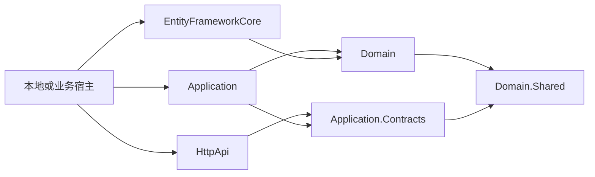
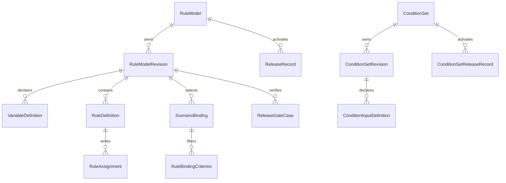
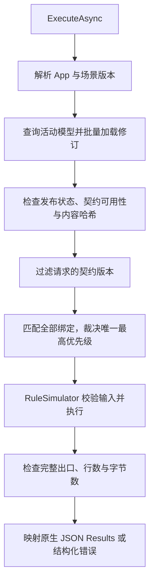

# NRuleEngine 系统架构说明

本文描述当前代码结构、调用路径、数据一致性及集成边界。产品能力与未实现项以[产品功能说明](../product/features.md)为准；协议细节见[API 参考](../reference/api.md)和[表达式与值结构](../reference/expressions.md)。

## 1. 技术基线与部署形态

组件、联调 Host 和测试均使用 net8.0。ABP 与 EF Core SQLite 包版本为 8.0.4，依赖由 Directory.Packages.props 集中管理；global.json 采用 8.0.400 SDK 基线并允许同主版本最新功能带，C# 使用 SDK 稳定默认版本。构建入口为 NRuleEngine.sln。

组件通过 ABP 模块嵌入宿主，宿主可以直接调用应用服务，HTTP 由 HttpApi 层提供。仓库中的 NRuleEngine.Host 是本地联调程序，使用 SQLite 和自动授权开发身份，不是生产宿主。Docker Compose 也仅启动该联调程序。

## 2. 模块职责与依赖

| 项目 | 职责 |
| --- | --- |
| Domain.Shared | 枚举、错误码、类型描述、场景描述及贡献者接口 |
| Domain | 聚合、业务不变量、AST 解释、完整校验、试算、门禁、哈希及仓储接口 |
| Application.Contracts | 应用服务接口、DTO 和权限定义 |
| Application | 加载数据、并发检查、事务编排、发布与运行、DTO 转换 |
| EntityFrameworkCore | DbContext、映射、仓储、发布协调行和修订并发适配 |
| HttpApi | 路由、HTTP 授权和协议转发 |
| Host | 本机启动、演示契约、SQLite、认证与 CORS 装配 |

箭头表示引用及模块依赖。Domain 不依赖 Application、HttpApi 或接入方业务仓储。表达式和执行器目前属于模块内部实现，没有单独的 Abstractions、Runtime 或 HttpApi.Client 包，也没有运行时缓存。

## 3. 场景注册与契约边界

[NRuleEngineDomainModule](../../src/NRuleEngine.Domain/NRuleEngineDomainModule.cs) 注册单例 RuleCatalog，并在初始化时依次收集：

1. IRuleAppContributor：注册 RuleAppDescriptor。
2. IRuleScenarioContributor：注册赋值型 RuleScenarioDescriptor。
3. IConditionScenarioContributor：注册 ConditionScenarioDescriptor。

RuleCatalog 校验应用已注册、契约键唯一、变量编码及方向合法、类型约束和绑定维度合法，并保存只读快照。初始化后禁止继续添加，目录仅驻留内存；没有数据库目录投影、Unavailable 状态同步或自动契约兼容分析。

赋值场景包含 AppCode、ScenarioCode、ContractVersion、Inputs、RequiredOutputs、BindingDimensions、ResultCardinality。条件场景只有输入契约。RuleTypeDescriptor 使用固定 Kind、可空性、精度、小数位、EnumCode 和 Shape；EnumCode 是类型标识，不是动态枚举候选值目录。

修订创建时实例化契约变量并保存精确版本与结果基数。复制沿用原契约及稳定键；运行查找锁定版本的注册契约，不自动迁移。宿主不得在同一版本号下改变字段含义；移除仍被使用的旧契约会使相关修订不可用。场景升级目前没有服务入口。

AppCode 用于目录和查询隔离、应用内编码唯一性，不提供租户、工厂、组织或行级权限隔离。

## 4. 领域模型

| 对象/字段 | 技术语义 |
| --- | --- |
| RuleModel / ConditionSet | 固定应用、场景和应用内唯一编码；持有 ActiveRevisionId、状态及并发戳 |
| Revision | 完整快照边界，保存修订号、来源修订、状态、精确契约版本、内容哈希及独立并发戳 |
| RevisionNo | 集合内递增的展示序号，不是并发戳或全局标识 |
| BasedOnRevisionId | 内容复制的来源，不表示运行时继承 |
| VariableDefinition.Id | 当前修订内实体行标识 |
| StableKey | Guid 逻辑身份，AST 和赋值目标使用它，跨修订/模型复制保留 |
| Code | 输入输出 JSON 的字段编码及展示别名；用户中间变量改名不改变 StableKey |
| Origin / Direction | Contract 或 UserDefined；Input、Intermediate 或 Output，控制维护与赋值范围 |
| RuleDefinition | 布尔条件、Priority、SortOrder、启用状态及赋值集合 |
| RuleAssignment | 目标 StableKey、Constant/Expression 来源及 SortOrder |
| ScenarioBinding | 所属修订的契约、优先级及 AND 维度条件，不含生效期 |
| ReleaseRecord | 激活目标、前一修订、发布序号、类型、哈希、校验摘要、说明和审计字段 |
| ReleaseScope | AppCode + ScenarioCode 唯一的数据库发布协调行 |

契约变量通过 Origin=Contract、Code 和精确契约关联，没有额外 ContractVariableKey。删除用户变量再建同名变量会生成新的 StableKey；修订复制则创建新的实体 ID 并保留变量稳定键。来源规则 ID 仅作结果定位，不作为门禁预期。

## 5. 草稿写入与影响分析

调用路径为 `Controller → AppService → 聚合方法 → Repository → EF Core`。修订是变量、规则、赋值、绑定和门禁的共同一致性边界。

应用服务校验期望并发戳，领域对象限制仅 Draft 可写。成功写入返回更新后的修订及并发戳。模型创建草稿、归档和发布等操作另使用模型并发戳。过期写入不得静默覆盖。

ABP 8 不会仅因子集合变化自动更新修订根实体。[EfCoreRuleModelRevisionRepository.UpdateAsync](../../src/NRuleEngine.EntityFrameworkCore/RuleModels/EfCoreRuleModelRevisionRepository.cs) 显式标记 ConcurrencyStamp 已修改，让子对象变更生成新戳并参与数据库乐观并发检查。

[RuleRevisionImpactAnalyzer](../../src/NRuleEngine.Domain/RuleModels/RuleRevisionImpactAnalyzer.cs) 按当前 AST、目标变量和门禁扫描直接引用及下游影响，没有 ExpressionReference 持久化投影。中间变量删除再次检查引用与并发；规则/赋值删除和归档影响仅提示。已发布快照不受草稿删除影响。

不采用 ISoftDelete。归档停止参与运行且保留历史，已发布修订没有修改或删除入口。Abandoned 领域状态存在，但没有废弃管理 API、定时物理清理或已确定的保留期。

## 6. 表达式、校验与求值

AST v1 是权威执行内容，ConditionSource/ExpressionSource 仅供展示。变量节点以 StableKey 定位，表达式不通过反射调用任意业务方法。数值使用 decimal，Round 使用 MidpointRounding.AwayFromZero，类型与精度不符时拒绝，不自动转为 double。

- RuleExpressionEngine：解析 AST、检查标量节点/函数/引用并求值。
- RuleValueEngine：在标量引擎之上处理区间或列表出口，遍历所有子表达式检查引用。
- RuleRevisionValidator：检查必需出口、依赖、重复写入、执行模式及修订内绑定歧义。
- RuleSimulator：同一路径校验输入、选择本修订绑定、执行条件/赋值并组装结果行。

保存时检查当前对象，完整校验和试算处理整份修订。Sequential 检查赋值依赖环，ErrorOnMultipleWrite 静态拒绝启用规则潜在的重复目标，即使条件可能互斥。CollectMatches 检查每行初始化和出口覆盖，禁止跨规则依赖。

默认值只补缺失入口或尚未写入的中间变量；显式 null 按可空性处理。复合输出整体赋值，不能从单值公式引用复合出口，也不能逐项追加列表。资源边界与 JSON 格式见[表达式参考](../reference/expressions.md)。

## 7. 发布、回滚与内容完整性

RuleReleaseAppService 在新的事务工作单元中发布：

1. 加载模型与完整草稿，检查模型及修订并发戳和状态。
2. 更新同场景 ReleaseScope 协调行获得数据库写锁；首次创建由唯一约束防止竞争插入。
3. 读取精确场景契约，完整校验修订，检查其他活动模型的同优先级绑定重叠。
4. 使用 RuleSimulator 执行全部门禁样本，比较状态及完整有序出口数组。
5. 计算内容哈希，冻结修订，切换模型活动指针并追加 ReleaseRecord。
6. 完成同一事务；任一步失败不激活草稿。

跨模型协调依赖数据库，不使用进程内锁替代。SQLite 已有组件级测试；接入其他数据库仍须验证其隔离级别、竞争发布和迁移行为。

回滚检查当前活动指针、模型和目标修订并发戳、历史发布状态、哈希、精确契约及当前跨模型绑定冲突。回滚不重写目标快照，产生新的激活记录。条件集的发布也在事务内完成双并发戳、契约、正反样本、哈希及活动指针切换，使用独立发布记录。

RuleRevisionContentHasher 生成 `sha256:v1:<hex>`，规范化对象字段及内容顺序，覆盖应用/场景/版本、结果基数、执行方式、写入策略、变量稳定身份与类型/默认值/单位、规则 AST 和顺序、赋值、绑定及门禁预期。数据库行 ID、修订 ID、审计、并发戳和纯展示文本不参与哈希。

哈希是内容完整性校验，不是签名、授权凭据或并发戳。运行时批量加载活动修订并检查哈希；损坏走异常通道。JSON 门禁结构比较使用 RuleJsonComparer，对象字段顺序无关、数组顺序保留，数值按有效数字与十进制指数精确比较，避免把 `1e-29` 当成 `0`；规则实际数值运算仍使用 decimal。

## 8. 规则集运行链路

请求通过可选 ContractVersion 限制参与选择的修订；不指定时不等于自动选择最新版本。当前实现先检查所加载活动修订的完整性与契约可用性，再应用版本过滤。

FirstMatch 只执行第一条命中规则；Sequential 将每次赋值写回共享上下文；CollectMatches 每条规则重置为相同初始值。规则按 Priority 降序、SortOrder 升序，赋值按 SortOrder 升序。同级规则顺序及同规则赋值顺序须唯一。

ResultCardinality.Single 成功一行，Many 成功 1–100 行。每行包含 SourceRuleIds 与原生 JSON Outputs；Sequential 来源包含全部命中规则，其余模式每行一个来源。列表出口与跨规则多行是不同概念。结果不排序字段值、不去重，不丢失同一行的字段对应关系。

无绑定或无规则命中返回 NotMatched。条件/赋值失败、缺少出口或结果超限不交付部分 Results；试算可以保留此前的诊断，但这些诊断不是业务结果。

## 9. 条件集运行链路

`ConditionSetAppService.EvaluateAsync → 按 CandidateCodes 查询条件集 → 批量读取活动修订 → ConditionSetEvaluator.Evaluate`。请求提供精确版本、完整输入及 1–100 个唯一候选编码，不扫描整个场景寻找业务候选。

判定器验证候选状态、发布哈希、契约快照及输入，再按优先级降序、编码升序计算。AllMatches 收集全部命中；FirstMatch 仍检查赢家同优先级的其他候选，多个命中返回 AmbiguousMatch，确定赢家后跳过更低优先级。

返回 Succeeded、Matched、Matches 及独立错误字段。正常不命中是判定成功，候选编码映射业务对象由宿主完成。目录查找等前置契约错误仍可能抛出 BusinessException，不能把条件判定协议理解为吞掉所有异常。

## 10. 错误、时间预算与权限

规则集的确定性结果使用 RuleExecutionStatus 与 Error.Code；运行服务生成 ExecutionId。底层试算诊断码由应用服务映射为 Domain.Shared 的稳定运行错误码，不能混用。系统存储故障、发布内容损坏、超时和未知异常使用 ABP 异常通道，具体码见[API 参考](../reference/api.md)。

RuleExecutionOptions.Timeout 默认为两秒，宿主配置，运行服务使用链接取消令牌传入加载、哈希及 AST 求值。进入 ExecuteAsync 前或执行中调用方取消，均原样传播 OperationCanceledException；调用方取消分支先于内部超时和通用异常处理，保留异常及其取消令牌。只有调用方未取消时，取消异常才转换为 System:Timeout；内部预算与调用方均已取消时优先传播调用方取消。

HTTP 目录要求认证；管理、发布和执行端点分别要求 Manage、Publish、Execute。模型发布历史用 Publish，条件集历史用 Manage。当前组件应用服务未统一声明这些授权属性，直接在进程内调用服务时宿主须自行建立授权边界，不能仅依赖 Controller。

面向客户端的运行错误只携带错误码与必要定位信息，不回传完整输入、表达式、SQL 或异常堆栈。当前内置错误文本主要为中文，未建立中英文本地化资源。发布门禁输入及原型会话数据不自动脱敏，宿主应按实际业务范围控制访问。

## 11. 持久化与接入

[ConfigureNRuleEngine()](../../src/NRuleEngine.EntityFrameworkCore/NRuleEngineModelBuilderExtensions.cs) 配置以下表：

| 表组 | 表 |
| --- | --- |
| 规则集 | NreRuleModels、NreRuleModelRevisions、NreVariableDefinitions、NreRuleDefinitions、NreRuleAssignments |
| 绑定与发布 | NreScenarioBindings、NreRuleBindingCriteria、NreReleaseGateCases、NreReleaseRecords、NreReleaseScopes |
| 条件集 | NreConditionSets、NreConditionSetRevisions、NreConditionInputDefinitions、NreConditionSetReleaseRecords |

唯一约束覆盖 AppCode + Code、集合内修订号及发布号、RevisionId + StableKey/Code、规则同级顺序、赋值目标/顺序、绑定维度、门禁名称与发布协调范围。内容按修订存储，未建生产执行 Trace 表、目录投影或持久化引用投影。

宿主按层引用模块，装配实际 EF 提供程序、应用服务、权限和 HTTP；在宿主 DbContext 应用模型配置，并由宿主的迁移流程生成和审核迁移。本地 Host 使用 EnsureCreatedAsync 仅创建新库，不能更新已有表结构。开发库有保留需求时不得直接删除，应使用新库或明确的迁移方式。

当前项目未被业务系统集成，不提供旧 AST、旧内容哈希或旧数据库结构兼容分支。后续一旦引入实际集成或数据保留要求，应另行确定兼容边界。组件不包含 ODS 数据、生产配置或旧引擎适配。

## 12. 测试层次与限制

Domain.Tests 覆盖注册、编制约束、默认值、AST、精度、依赖、执行模式、复合值、多行限额和内容哈希；Application.Tests 覆盖 SQLite 下的保存读回、复制、门禁、发布回滚、执行状态与并发；EntityFrameworkCore.Tests 覆盖模块装配、映射和唯一约束。

原型 Node.js 测试验证浏览器侧本地执行预览，与后端测试属于不同证据。FirstMatch、Sequential、CollectMatches 无规则命中均返回 NotMatched、NoMatchingRule 和空结果，与后端试算一致；未命中不会继续检查出口完整性或执行赋值，已有默认值也不会形成业务结果。已命中但缺少必需出口仍是计算失败。

[RuleExecutionCancellationTests](../../test/NRuleEngine.Application.Tests/RuleExecutionCancellationTests.cs) 使用受控异步执行段验证执行中取消及同时超时的取消优先级；既有运行测试覆盖进入执行前已取消和内部预算超时。这些测试验证执行入口的异常分流，不代表实际 HTTP 断连或所有数据库驱动的取消行为已完成环境验收。

当前测试不能替代生产鉴权、多实例竞争压力、其他数据库提供程序、正式浏览器联调或真实业务同输入对照。验证命令及本地启动方式见[后端指南](../../BACKEND.md)，未实现能力集中列于[产品说明第 10 节](../product/features.md#10-未实现项与后续边界)。
